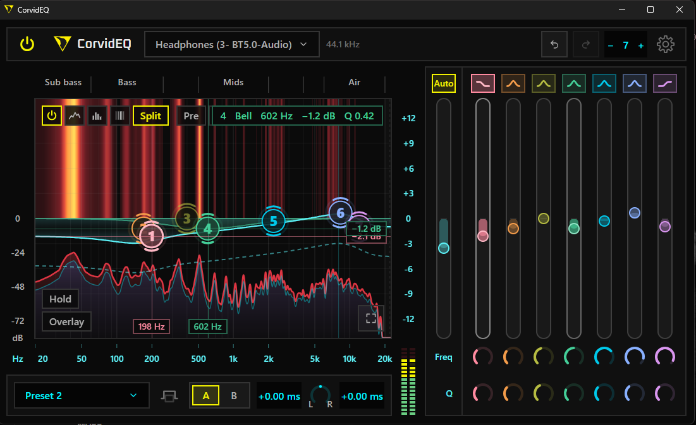

# CorvidEQ

A visual parametric EQ for Windows. Shape your sound by dragging points on a
curve; Equalizer APO applies it system-wide.

> **Heads-up:** CorvidEQ is an early release, still in testing. It started as
> a personal tool, and its code was written largely by AI. It's shared in good will, as is, with no warranty. It edits
> Equalizer APO's config, so back up your files before using it.

Inspired by Fruity Parametric EQ 2. Not affiliated with Image-Line.

FL Studio raised a generation of musicians with tools that teach by being fun,
and easy enough for a kid to use. CorvidEQ tries to do the same.



## Features

- Up to 20 bands: drag nodes on the graph, or use faders and knobs
- Every value can be dragged or scrolled
- Live analyzer behind the curve: line, bars or heat map
- A separate EQ for each device, switched automatically
- Split left/right EQ, with balance and delay
- A/B comparison, undo/redo, anti-clip level
- Presets, with import from Equalizer APO and other EQ apps
- Keeps working after the app closes

## Install

1. Install Equalizer APO,
   tick your outputs in its Device Selector, and restart Windows.
2. Back up Equalizer APO's `config` folder.
3. Download the installer from
   [Releases](https://github.com/eegor111/CorvidEQ/releases/latest).
   `SHA256SUMS.txt` there lets you verify it.
4. If Windows SmartScreen warns you: the installer isn't code-signed. Click
   **More info → Run anyway**.
5. Press the power button (top left) to switch CorvidEQ on.

Windows 10/11, 64-bit. Updates install from inside the app.

## What it touches

- **Equalizer APO's config folder:** writes `corvid-eq.txt`. Switching on
  backs up `config.txt` as `config-before-corvideq.txt` and points it at
  CorvidEQ; switching off (or uninstalling) restores it exactly.
- **`%LOCALAPPDATA%\com.igormitrovic.corvideq`:** settings, presets and a
  small error log.
- **Registry:** reads Equalizer APO's paths and device effect lists. Writes
  one `Run` entry only if you turn on *Run on startup*.
- **Audio:** listens to the chosen output for the analyzer. Nothing is
  recorded.
- **Network:** checks GitHub for updates at startup. Nothing else, no
  tracking.

## Updates & support

Slow but steady: CorvidEQ is a side tool next to a bigger main project, but
it's in heavy daily use.

<!-- TODO: name and link 3DNS here once it's public. -->

Bugs and ideas: [open an issue](https://github.com/eegor111/CorvidEQ/issues).
Replies may take a while.

## Build from source

Needs [Node.js](https://nodejs.org), [Rust](https://rustup.rs) and the
Microsoft C++ Build Tools.

```bash
npm install
npm run tauri dev
```

Code overview: [`docs/overview.md`](docs/overview.md).

## Credits & license

- Equalizer APO by Jonas Thedering
- Audio EQ Cookbook by Robert Bristow-Johnson
- [Oxanium](https://fonts.google.com/specimen/Oxanium) font by Severin Meyer (OFL)
- Built with [Tauri](https://tauri.app) and [React](https://react.dev)

Copyright © 2026 Igor Mitrović. [MIT License](LICENSE). Provided as is, no warranty.
